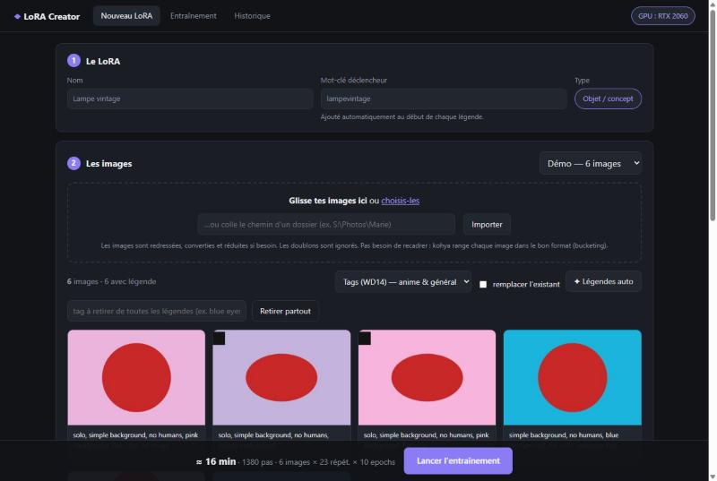
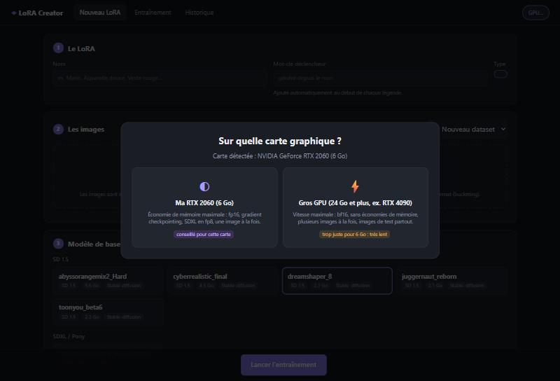
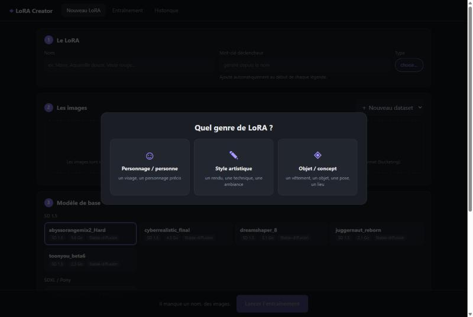
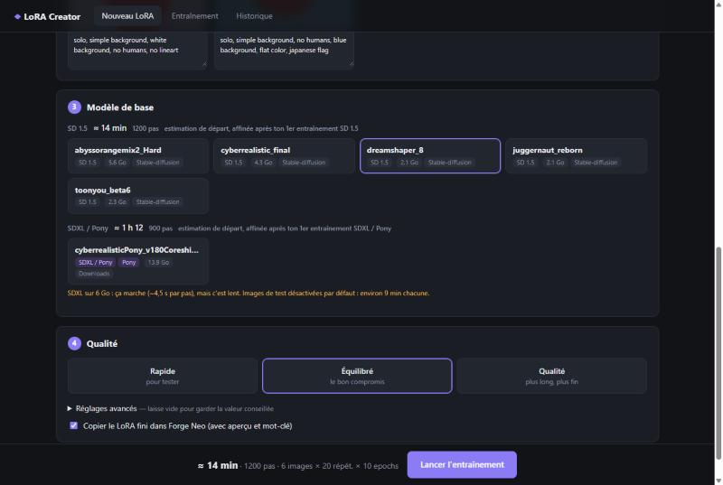
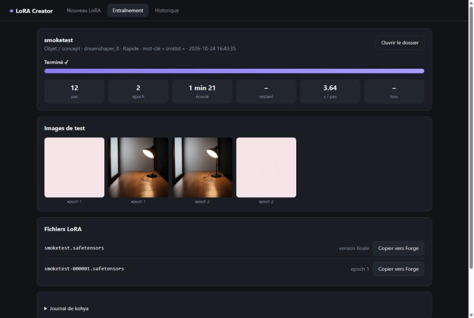

<div align="center">

# ◆ LoRA Creator

**Une interface minimaliste pour entraîner des LoRA avec [kohya_ss](https://github.com/bmaltais/kohya_ss), sans régler 25 paramètres à chaque fois.**

Deux profils de carte au choix : petite carte (testée sur une RTX 2060 6 Go) ou gros GPU (RTX 4090…) · SD 1.5 et SDXL / Pony · Windows et Linux




</div>

<details>
<summary><b>🇬🇧 English summary</b></summary>

**LoRA Creator** is a minimal web UI that drives [kohya_ss](https://github.com/bmaltais/kohya_ss) sd-scripts
so you don't have to set 25 parameters for every LoRA. *(The interface is in French for now.)*

- Pick your GPU profile at launch: **small card (6–8 GB, tested on an RTX 2060)** or **big GPU (24 GB+)**.
  Precision, memory savings, batch size and learning rates follow automatically.
- Pick a LoRA type (character / style / object), drop your images, click **auto captions** (WD14 tags on GPU or BLIP),
  choose a checkpoint (**SD 1.5, SDXL, Pony**) and a quality level (Fast / Balanced / Quality) → **Start**.
- Training time is estimated before you start, then recalibrated from your real runs.
- Live progress, loss, sample images, per-epoch files, full history with **re-run with same settings**.
- Finished LoRAs are copied to Forge / A1111 `models/Lora` with a preview and trigger word, never overwriting anything.

**Install:** have kohya_ss installed (tested with v26), `git clone https://github.com/ArthureCodage/lora-creator.git`,
then run `Lancer LoRA Creator.bat` (Windows) or `./lancer-lora-creator.sh` (Linux). Nothing else to install.

Want it in the cloud? **[DonoGenSoft](https://github.com/ArthureCodage/DonoGenSoft)** installs kohya_ss + LoRA Creator + Forge Neo on vast.ai / RunPod in one command.

</details>

---

## Pourquoi ?

La GUI de kohya_ss est puissante, mais elle expose des centaines de réglages. Pour entraîner un LoRA « normal »,
on finit toujours par recharger un preset, vérifier les chemins, recalculer les répétitions…

**LoRA Creator** garde kohya comme moteur, mais fixe une fois pour toutes les réglages techniques adaptés
à ta machine. À l'écran, il ne reste que ce qui compte :

> **le type de LoRA · un nom · des images · un modèle · une qualité → Lancer.**

## Fonctionnalités

| | |
|---|---|
| 🖥️ **Carte graphique demandée au lancement** | Petite carte (6–8 Go) ou gros GPU (24 Go et plus). La carte est détectée et le bon choix est proposé. Tous les réglages techniques suivent : précision, économies de mémoire, taille de batch, learning rate, images de test, estimations. Changeable à tout moment depuis l'en-tête. |
| 🎯 **Type demandé en popup** | Personnage, style ou objet/concept : chaque type a ses presets (dimension, nombre de pas, prompts de test). |
| 🖼️ **Préparation des images** | Glisser-déposer de fichiers ou d'un dossier entier, import par chemin. Images redressées (EXIF), converties, réduites, doublons ignorés. Pas de recadrage : le *bucketing* de kohya s'en charge. |
| 🏷️ **Légendes automatiques** | Tags WD14 (swinv2 v3, sur GPU via ONNX) ou phrases BLIP. Éditeur de légendes en grille, suppression d'un tag partout en un clic. Le mot-clé est ajouté automatiquement (`caption_prefix`), les fichiers ne sont pas modifiés. |
| ⏱️ **Estimation du temps** | Affichée pour SD 1.5 **et** SDXL avant de lancer, puis recalibrée automatiquement à partir de tes vrais entraînements. |
| 🎚️ **3 niveaux de qualité** | Rapide / Équilibré / Qualité. Les répétitions et epochs sont calculées selon la taille du dataset. Un volet « Avancé » replié permet de tout ajuster. |
| 📈 **Suivi en direct** | Progression, temps restant, loss, images de test à chaque sauvegarde, journal kohya, bouton d'arrêt. |
| 📦 **Copie vers Forge / A1111** | Le LoRA fini est copié dans `models/Lora` avec son aperçu et un `.json` (mot-clé, poids conseillé, version SD). Aucun LoRA existant n'est jamais écrasé. |
| 🗂️ **Historique** | Chaque entraînement est gardé (réglages, durée, aperçus, fichiers par epoch) avec un bouton **Relancer avec les mêmes réglages**. |

<table>
<tr>
<td></td>
<td></td>
</tr>
<tr>
<td align="center"><sub>La carte graphique est demandée au lancement</sub></td>
<td align="center"><sub>Le type est demandé à chaque nouveau LoRA</sub></td>
</tr>
<tr>
<td colspan="2"></td>
</tr>
<tr>
<td colspan="2" align="center"><sub>Temps estimé pour SD 1.5 et SDXL / Pony</sub></td>
</tr>
<tr>
<td colspan="2"></td>
</tr>
<tr>
<td colspan="2" align="center"><sub>Suivi de l'entraînement, images de test et fichiers par epoch</sub></td>
</tr>
</table>

## Installation

**Prérequis :** Windows ou Linux, une carte NVIDIA et [kohya_ss](https://github.com/bmaltais/kohya_ss) déjà installé (testé avec la v26).
LoRA Creator n'installe rien : il utilise le Python et les paquets de kohya (FastAPI, Pillow, onnxruntime…).

```bash
git clone https://github.com/ArthureCodage/lora-creator.git
```

### Windows

Double-clic sur **`Lancer LoRA Creator.bat`**. Il cherche kohya dans `%USERPROFILE%\kohya_ss`.
Sinon, définis la variable d'environnement `KOHYA_DIR`. Pour arrêter l'appli, ferme la fenêtre noire.

### Linux

```bash
cd lora-creator
./lancer-lora-creator.sh
```

Le script cherche kohya dans `~/kohya_ss`. Sinon : `KOHYA_DIR=/chemin/vers/kohya_ss ./lancer-lora-creator.sh`.
Arrêt avec `Ctrl+C`.

**Sur une machine distante (serveur, location de GPU type vast.ai / RunPod)**, deux possibilités :

```bash
# 1. Tunnel SSH depuis ton PC (recommandé : l'interface reste privée)
ssh -L 7870:127.0.0.1:7870 utilisateur@serveur
# puis, sur le serveur :
./lancer-lora-creator.sh --no-browser
# et ouvre http://127.0.0.1:7870 sur ton PC

# 2. Écoute sur toutes les interfaces (uniquement sur un réseau de confiance : l'interface n'a pas de mot de passe)
./lancer-lora-creator.sh --no-browser --host 0.0.0.0 --port 7870
```

Sans écran, le bouton « Ouvrir le dossier » affiche simplement le chemin.

### Configuration

Au premier lancement, `config.json` est créé depuis [`config.example.json`](config.example.json).
Les chemins acceptent `~` (et `%USERPROFILE%` sous Windows). Adapte-les, puis relance :

| Clé | Rôle |
|---|---|
| `kohya_dir` | Dossier d'installation de kohya_ss |
| `python` | *(optionnel)* Python à utiliser si ce n'est pas le `venv` de kohya |
| `data_dir` | Où ranger datasets, entraînements et LoRA produits |
| `forge_lora_dir` | Dossier `models/Lora` de Forge / A1111 (copie automatique) |
| `model_dirs` | Dossiers où chercher les checkpoints `.safetensors` (SD 1.5 et SDXL détectés automatiquement) |
| `host` / `port` | Adresse d'écoute de l'interface (`127.0.0.1:7870` par défaut) |
| `tagger_repo` | Modèle WD14 utilisé pour les tags |

## Utilisation

0. **Au lancement** : choisis ta carte graphique (petite carte ou gros GPU). Le choix conseillé est indiqué selon la carte détectée.
   Tu peux en changer à tout moment avec le bouton **GPU** en haut à droite.
1. **Nouveau LoRA** : choisis le type, donne un nom. Le mot-clé déclencheur est proposé automatiquement.
2. **Images** : glisse tes images, clique sur **Légendes auto**, corrige si besoin.
3. **Modèle** : choisis le checkpoint. Le temps estimé est affiché pour chaque famille.
4. **Qualité** : Rapide pour tester, Équilibré par défaut, Qualité pour le rendu final.
5. **Lancer** : suis la progression dans l'onglet *Entraînement*. Le LoRA arrive tout seul dans Forge.

## Réglages fixés

**Communs aux deux profils** : AdamW8bit, `cosine_with_restarts`, cache des latents sur disque, `min_snr_gamma = 5`,
bucketing, environ 5 sauvegardes par entraînement pour pouvoir choisir le meilleur epoch.
SD 1.5 : 512 px, clip skip 2, shuffle caption, dim 32 / alpha 16 (style : 64/32).
SDXL / Pony : 1024 px, U-Net seul, cache des sorties du text encoder, `no_half_vae`, dim 32 / alpha 16.
Pour les modèles Pony, des tags `score_*` sont ajoutés aux prompts de test.

**Selon la carte choisie au lancement :**

| | Petite carte (6–8 Go) | Gros GPU (24 Go et plus) |
|---|---|---|
| Précision | fp16 | bf16 |
| Économies de mémoire | gradient checkpointing, xformers, SDXL en `fp8_base` | aucune (SDPA) |
| Images à la fois (batch) | 1 | SD 1.5 : 4 · SDXL : 2 |
| LR U-Net | 1e-4 | SD 1.5 : 2e-4 · SDXL : 1,5e-4 |
| LR text encoder (SD 1.5) | 5e-5 | 1e-4 |
| Images de test SDXL | désactivées (≈ 9 min chacune) | activées |
| Résolutions SDXL proposées | 768 · 896 · 1024 | 768 · 896 · 1024 · 1280 |

Le volume d'entraînement est le même dans les deux profils : avec un batch plus grand, il y a moins de pas,
mais chaque pas voit plusieurs images. Nombre d'images vues visé (= pas à batch 1) :

| | Rapide | Équilibré | Qualité |
|---|---:|---:|---:|
| SD 1.5 · personnage | 700 | 1 400 | 2 400 |
| SD 1.5 · style | 1 000 | 1 800 | 3 000 |
| SD 1.5 · objet | 600 | 1 200 | 2 000 |
| SDXL · personnage | 500 | 1 000 | 1 600 |
| SDXL · style | 700 | 1 300 | 2 000 |
| SDXL · objet | 450 | 900 | 1 400 |

> **SDXL sur 6 Go** : l'entraînement fonctionne (≈ 4,5 s/pas à 1024 px sur RTX 2060), mais une image de test prend
> environ 9 minutes, car la VRAM déborde dans la RAM. Les images de test sont donc désactivées par défaut en SDXL.
>
> **Profil « Gros GPU » sur une petite carte** : à éviter. Sans les économies de mémoire, la VRAM déborde et
> l'entraînement devient extrêmement lent. Le popup le signale quand la carte détectée a moins de 16 Go.

Les estimations de temps partent de valeurs de départ par profil, puis se recalent sur tes vrais entraînements
(séparément pour chaque profil).

Tous ces réglages sont dans [`app/engine.py`](app/engine.py), en haut du fichier.

## Organisation des données

```
data_dir/
├── datasets/<nom>/        images préparées + légendes .txt
├── runs/<date-nom>/       un dossier par entraînement
│   ├── run.json           historique (réglages, durée, mesures)
│   ├── config.toml        arguments passés à sd-scripts
│   ├── dataset.toml       config du dataset (répétitions, mot-clé)
│   ├── train.log          journal complet
│   └── output/            LoRA par epoch + sample/
├── LoRA/                  copie de chaque LoRA final
└── models/wd14/           modèle de tagging (téléchargé au 1er usage)
```

## Structure du code

```
Lancer LoRA Creator.bat   lanceur Windows
lancer-lora-creator.sh    lanceur Linux (options : --host, --port, --no-browser)
config.example.json       modèle de configuration
app/
├── engine.py      profils GPU, presets, estimation, datasets, lancement de sd-scripts, historique, copie Forge
├── server.py      API FastAPI + fichiers statiques
└── static/        interface (HTML / CSS / JS vanilla, aucune étape de build)
```

## Licence

[MIT](LICENSE). LoRA Creator n'est pas affilié à kohya_ss. Il se contente de piloter ses scripts.
